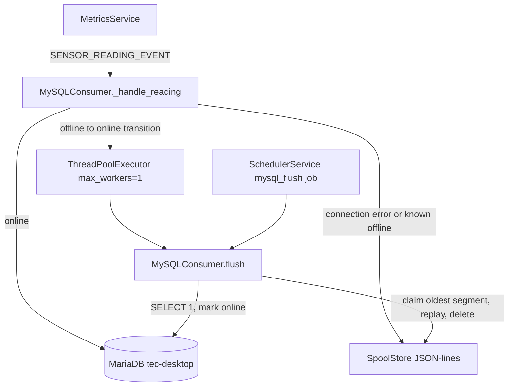

# piSolar Offline Spool Store

Companion to [WeatherWatch `offline_spool_store`](https://github.com/tim-oe/WeatherWatch/blob/main/.cursor/plans/offline_spool_store_de6e98d4.plan.md) (its Phases 3-7). piSolar needs a much smaller version because:

- It already uses UTC. `SensorReading.read_time` is `datetime.now(timezone.utc)`, and `from_reading()` strips `tzinfo`. So that plan's Phase 2 and the convention-agnostic codec concerns do not apply. The spool stores naive UTC.
- Startup already works without the DB. `create_db_engine()` is lazy, there is no reflection, and the scheduler is in-memory. Nothing like WeatherWatch's Phase 3 constructor fixes is needed.
- piSolar never reads from the DB, so WeatherWatch's Phase 6 (degrading reads) does not apply.
- There is no DB backup and no camera rsync, so WeatherWatch's Phase 1 does not apply.
- There are two tables (`solar_reading` and `solar_temperature_reading`) and a single write funnel, `MySQLConsumer._handle_reading`.

What it does need: today an outage silently drops every reading, because `_handle_reading` catches `Exception` and logs it.

## Decisions locked in

- **Spool format:** JSON-lines, same layout as WeatherWatch: `{folder}/{table}/{YYYYMMDDTHH}.jsonl`, hourly segments, `.draining` rename, and 14% free-disk eviction. It is independent of `storage.enabled` (the SQLite store).
- **Delivery:** at-least-once, and rare duplicates are accepted. The schema (WeatherWatch `sql/schema/V1_2_0__solar.sql`) has `PRIMARY KEY (id, read_time)` and no unique key. So there is no schema change and no `IntegrityError`-as-delivered logic. To keep the duplicate window to one segment, the drain commits and deletes per segment.
- **Model resolution:** the envelope carries `table`, and the drain resolves the ORM class from `Base.registry.mappers` by `__tablename__`. Unlike WeatherWatch's dotted repository path, there are no repositories here; adding a new model to `Base` is enough.
- **Alerts:** log at error/warning only. piSolar has no emailer.

## Architecture



## 1. Engine timeouts and connection state

[src/pisolar/services/db/base.py](src/pisolar/services/db/base.py) `create_db_engine()`:
- Add `connect_args` with connect/read/write timeouts. The keys are driver-specific: mysql-connector 9.6 (prod) uses `connection_timeout`/`read_timeout`/`write_timeout`, while pymysql (tests) uses `connect_timeout`/`read_timeout`/`write_timeout`. Pick the keys from `make_url(url).drivername`, and check both against the installed drivers.
- [src/pisolar/config/mysql_config.py](src/pisolar/config/mysql_config.py): add `connect_timeout` (default 5), `read_timeout` and `write_timeout` (default 10), and `offline_retry_seconds` (default 60).

New `src/pisolar/services/db/db_state.py`:
- Lock-guarded `mark_offline()`, `mark_online() -> bool` (returns True only on an offline-to-online transition), and `is_offline()`, with a retry-after window `_offline_until`.
- The lock is needed because APScheduler's thread pool runs the temperature and renogy jobs concurrently.

## 2. Spool store and codec

New package `src/pisolar/services/spool/`:
- `spool_store.py` - `SpoolStore` is table-agnostic. Its API: `append(table, line)`, `tables()`, `claim_oldest(table) -> Path | None`, `release(path)`, `rewrite_remainder(path, lines)`, plus crash recovery of leftover `.draining` files at startup.
  - Each append takes a per-table `threading.Lock`, then opens the file, writes one line, flushes and fsyncs, and closes. The `.draining` rename takes the same lock.
  - Before each append, check `shutil.disk_usage`. Below `min_free_pct`, evict the oldest segment across tables, but never the active segment or a `.draining` one. Log the eviction at error, once per outage.
  - Log a warning once per outage when the oldest segment is older than `warn_age_hours`.
- `record_codec.py` - `encode(record) -> dict` and `decode(cls, data) -> record`, driven by `type(record).__table__.columns` and excluding `id`.
  - Dispatch on the column type: `DATETIME` becomes naive `isoformat()`, and decode rejects strings with an offset. `FLOAT`/`INTEGER`/`TINYINT`/`SMALLINT`/`VARCHAR` pass through as JSON scalars.
- Envelope format: `{"table": "solar_reading", "spooled_at": "<utc iso>", "data": {...}}`.

Config: new [src/pisolar/config/spool_config.py](src/pisolar/config/spool_config.py), registered on `Settings` in [src/pisolar/config/settings.py](src/pisolar/config/settings.py), plus this block in [config/config.yaml](config/config.yaml):

```yaml
spool:
  enabled: !ENV ${PISOLAR_SPOOL_ENABLED:true}
  folder: !ENV ${PISOLAR_SPOOL_FOLDER:/var/lib/piSolar/spool}
  min_free_pct: !ENV ${PISOLAR_SPOOL_MIN_FREE_PCT:14}
  warn_age_hours: !ENV ${PISOLAR_SPOOL_WARN_AGE_HOURS:24}
  flush_schedule:
    cron: !ENV ${PISOLAR_SPOOL_FLUSH_CRON:*/5 * * * *}
    enabled: !ENV ${PISOLAR_SPOOL_FLUSH_ENABLED:true}
```

The spool folder must be local storage, never an NFS mount.

## 3. Write path in MySQLConsumer

[src/pisolar/services/db/mysql_consumer.py](src/pisolar/services/db/mysql_consumer.py): split `_handle_reading` into `_to_record(reading)` and `_persist(record)`.
- If the DB is known offline, spool immediately and return.
- Otherwise commit. On success, call `mark_online()`. If that returns a transition, submit `flush()` to a single-worker `ThreadPoolExecutor`. `EventBus.publish` is synchronous, so running the drain inline would stall the sensor job.
- On connection-class errors (`OperationalError`, `InterfaceError`, or `DBAPIError` with `connection_invalidated`), call `mark_offline()`, spool the row, and log one warning per outage.
- Other errors keep today's behaviour: log and drop, never spool.
- If `spool.enabled` is false, behaviour stays as it is today.
- `close()` also shuts down the executor.

## 4. Flush

`MySQLConsumer.flush()`:
- Uses a non-blocking `threading.Lock`; a second trigger logs and returns.
- Runs a `SELECT 1` health check, then calls `mark_online()`. This is the way back online when nothing is writing.
- For each table directory found on disk:
  - Resolve the model from the registry. Unknown tables are quarantined to `{table}/rejected.jsonl`.
  - Claim the oldest segment, decode its lines, `add_all`, and commit once per segment. On success, delete the segment.
  - On a connection error, call `mark_offline()`, leave the `.draining` file in place for retry, and stop.
  - Lines that fail to decode go to `rejected.jsonl`.
- Logs a summary: rows replayed per table, rejected lines, and remaining depth.

Wire it in [src/pisolar/cli.py](src/pisolar/cli.py):
- `run()` registers a `mysql_flush` job through `SchedulerService.add_job` when MySQL and the spool are both enabled, and calls `flush()` once at startup to drain anything left over.
- Add a `pisolar flush` command for a manual drain.
- Extend `show_config` with the spool settings.

## 5. Tests

- `tests/services/spool/test_spool_store.py`: hourly rotation, `.draining` recovery, concurrent appends racing a rename, eviction order (patch `shutil.disk_usage`), and warnings latching once per outage.
- `tests/services/spool/test_record_codec.py`: a round trip of every mapper column for `SolarRecord` (built from `RENOGY_RAW_DATA`) and `TemperatureRecord`; offset-bearing datetimes are rejected.
- Extend [tests/services/db/test_mysql_consumer.py](tests/services/db/test_mysql_consumer.py):
  - A connection error spools and marks offline; a non-connection error does not spool.
  - The known-offline short circuit skips the engine.
  - A transition submits a flush exactly once.
  - Flush drains oldest-first into the testcontainer, deletes segments, leaves the `.draining` file on failure, quarantines unknown tables, and the re-entrancy lock works.
  - Outages are simulated by patching the engine/session to raise `OperationalError`, not by stopping the container.
- [tests/config/test_settings.py](tests/config/test_settings.py): `SpoolConfig` defaults and the env overrides.

## 6. Docs and verification

- [docs/CONFIGURATION.md](docs/CONFIGURATION.md): the `spool` block and the new `mysql` timeouts. [README.md](README.md): add a feature bullet. Also note that duplicates are possible after a crash mid-drain.
- `poetry run` lint and test targets must be green.
- Drill on the piSolar Pi against the real DB:
  - With `pisolar run` healthy, block the DB (stop MariaDB or firewall 3306). Confirm one offline warning, then `.jsonl` files growing under `/var/lib/piSolar/spool`.
  - Restore the DB. Confirm the next write triggers a drain, rows land with the correct `read_time`, and the spool empties.
  - Repeat as a cold start with the DB down from boot.
- This answers the home_server migration's Phase 3 reconnect question for piSolar.
